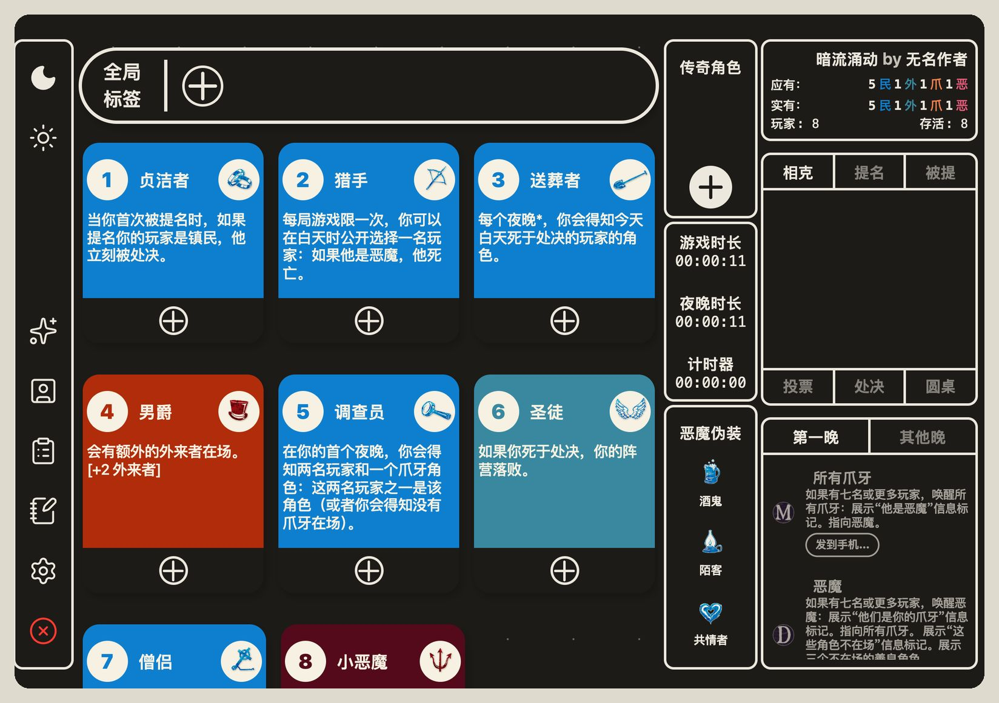
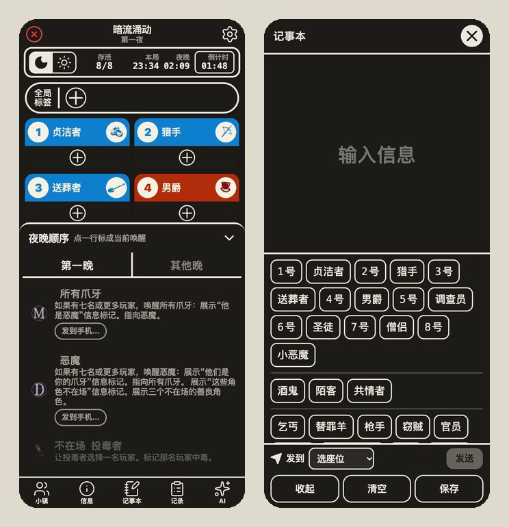
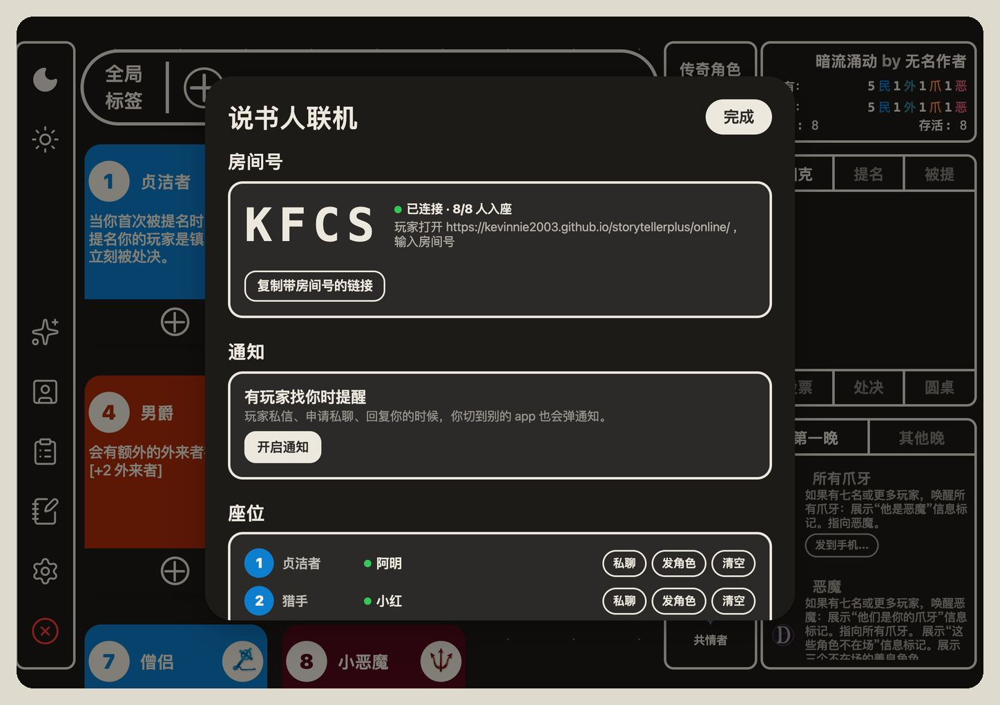
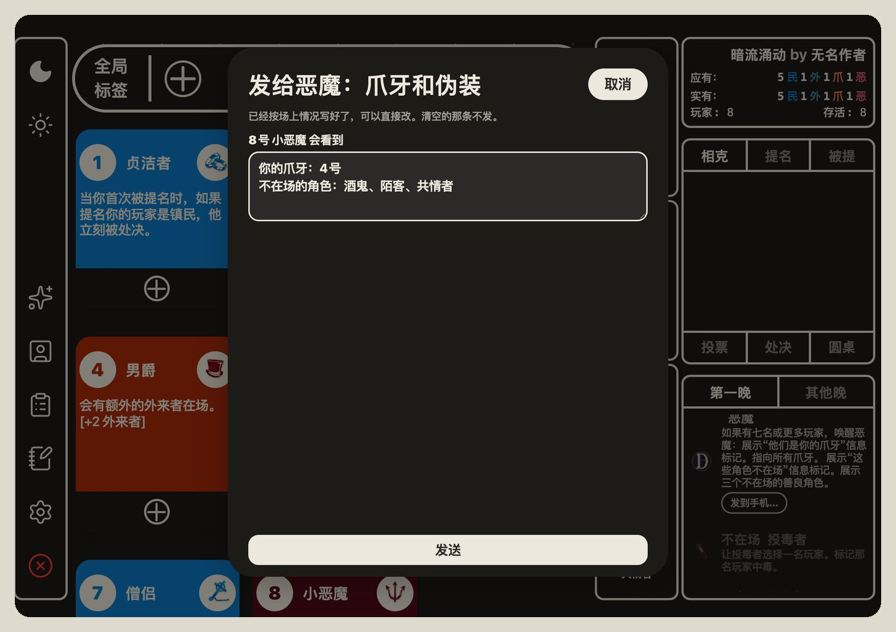
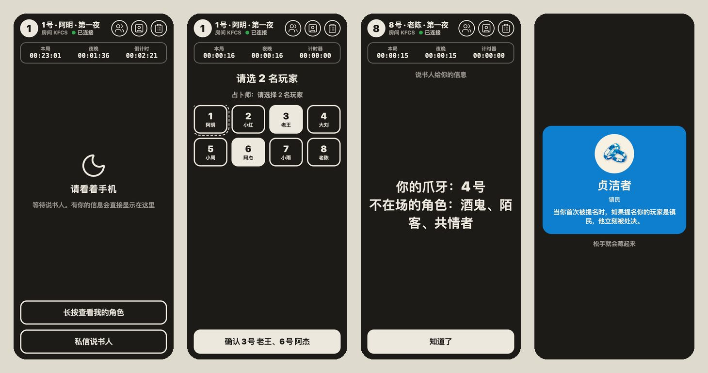
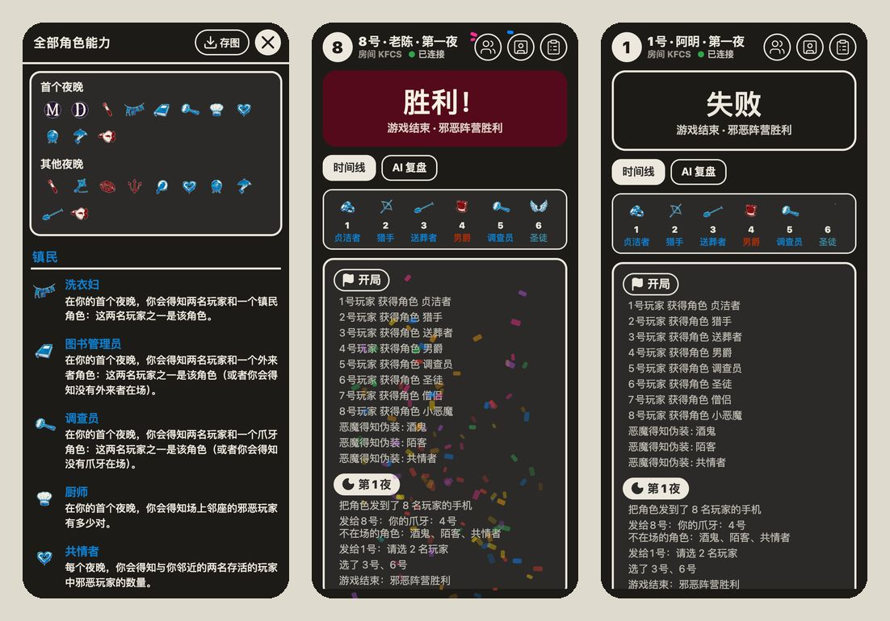
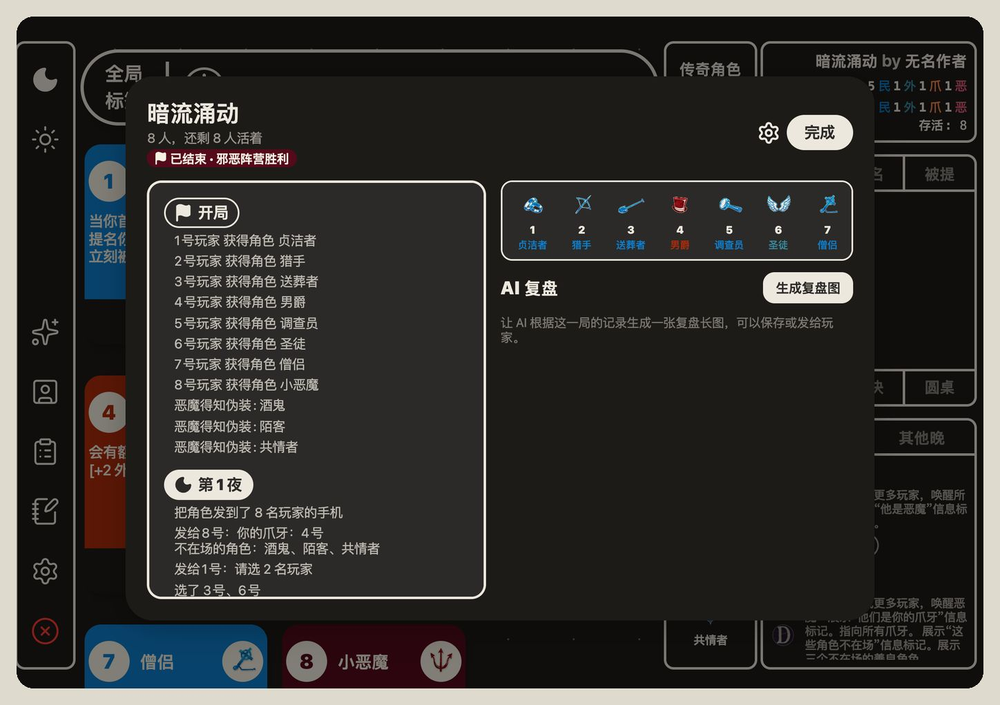

# 说书人普拉斯

给线下血染钟楼说书人用的魔典工具：导入剧本、配版、发角色、管魔典、过夜晚、主持投票、记录整局，还有 AI 帮你配版、出主意和做复盘。开了“说书人联机”之后，夜里的信息可以直接发到玩家手机上。

- **说书人（网页版）：https://kevinnie2003.github.io/storytellerplus/**
- **玩家联机页面：https://kevinnie2003.github.io/storytellerplus/online/**

本项目基于 [txstc55/storytellerplus](https://github.com/txstc55/storytellerplus) 二次开发，原版 app 的 TestFlight 在[这里](https://testflight.apple.com/join/4YpHAZGE)。

## 开始使用

### 打开

- **网页版（推荐）**：用浏览器打开上面的网址，手机、平板、电脑都能用。在 Safari 里点“分享 → 添加到主屏幕”，之后就能像 app 一样全屏打开。打开过一次以后，断网也能用。
- **iPad app**：需要 Mac 和 Xcode 自己安装，见最下面的“自己安装”。手机布局、说书人联机这些新功能只有网页版有。

网页版和 iPad app 的存档、设置互不相通。

### 第一次用

点开始页最下面的 **新手教程**，会用《暗流涌动》开一个 8 人演示局，从配版、玩家抽卡一直带你走到夜里。演示不会存档，随时可以退出。

### 带一局的流程

1. **导入剧本**：上传剧本 JSON，或者用“图片生成剧本”拍一张剧本图让 AI 读出来。
2. **定人数**：点齿轮，用 + − 调玩家人数。
3. **配版**：点“说书人配版”自己选角色，或者点“AI配版”让 AI 配好。
4. **发角色**：把平板递给玩家抽卡，或者直接给每个座位指定角色。用说书人联机的话，也可以把角色发到每个人手机上。
5. **开始游戏**：所有人都有角色后，在齿轮面板里点“开始游戏”，进入第一夜。
6. **夜晚**：按夜晚顺序一个个唤醒；要给玩家看信息，就在记事本里拼一句话，或者直接发到他手机上。
7. **白天**：点太阳天亮，提名、投票、处决；死亡和复活点一下座位号。
8. **结束游戏**：在齿轮面板里点“结束游戏”，选哪一方胜利，然后看复盘。分好角色的局都会自动存档。

### 手机上用

手机上是单独的一套布局：上面是卡片，下面是夜晚顺序或投票面板，底部一排是小镇、信息、记事本、记录和 AI。点角色名能看能力。记事本拼好一句话后点“收起”，就只剩大字，直接举给玩家看。

### 常用手势

- 弹出的面板（选角色、标签、记事本、整局记录等）：双击面板外面的空白处关掉。
- 卡片上的标签：双击删除，长按 1 秒倒置。
- 计时器：点一下暂停或继续，双击归零，长按设置倒计时。
- 点错了：屏幕底部出现“撤销”时点一下就能撤回。

## 说书人联机

大家还是坐在一起玩，但夜里不用闭眼，说书人也不用走动：信息直接发到玩家手机上，也能避免场外。白天的提名和投票还是在线下进行。

### 开房间和加入

1. 说书人在齿轮面板里选“说书人联机”，点“开房间”，得到一个 4 位房间号。也可以复制带房间号的链接发到群里。
2. 玩家用手机打开 https://kevinnie2003.github.io/storytellerplus/online/ ，输入房间号，填好昵称，点自己的座位。
3. 下一局可以接着用这个房间：房间面板里选“座位不变”或者“大家重新选座位”，玩家不用重新输房间号。

### 夜里

- 夜晚顺序的每一行有三个按钮：
  - **发信息**：用记事本拼一句话发给他，他看完点“知道了”，你这边显示已读。
  - **让他选**：他在手机上点座位号回传，座位号下面有昵称，不用抬头对座位。
  - **要他发动**：他在手机上打字告诉你他的选择，比如赌徒写下猜测。
- 首夜的爪牙信息和恶魔信息已经按场上情况写好，可以改完再发。提线木偶不会收到爪牙信息，恶魔会看到他是提线木偶；疯子不算恶魔，他的假信息你自己发。

### 玩家手机上

- 看自己的角色要长按，进度条走满才显示，松手就藏起来。
- 随时能看玩家列表（昵称、谁死了、死人票用没用）、这个剧本的全部角色能力和行动顺序、收到过的信息。夜里的死亡要等说书人点天亮才会更新。
- 能看到说书人的计时：本局时长、白天或夜晚的时长，还有说书人开的正计时或倒计时。
- 可以私信说书人、申请发动能力或者申请私聊，说书人那边会弹窗，可以直接回复，内容也会记进整局记录。

### 角色

- 分好角色后在房间面板里“发角色”，酒鬼这类可以改成要显示的角色。
- 之后谁的真实角色变了（比如舞蛇人换了恶魔），座位上会标“角色变了”，点那个座位的“发角色”只发给他一个人。
- iPhone 从 Safari 换到主屏幕打开时，用同样的昵称点原来的座位就能坐回去。

### 通知

- 玩家开了通知，说书人找他时手机会弹“说书人拍了拍你”，切到别的 app 也能收到。
- 说书人也可以在房间面板里开通知，玩家私信、申请私聊、回复你时弹“有玩家在找你”。
- 正在看页面时不弹，免得夜里手机一响暴露谁被唤醒。通知里不写具体内容。
- 安卓和电脑的浏览器点“开启”就行。iPhone、iPad 要先在 Safari 里“添加到主屏幕”，从主屏幕打开才能收。

### 结束游戏

- 在齿轮面板里点“结束游戏”，确认后选哪一方胜利。这一步不能撤销。
- 每个玩家手机上显示自己胜利还是失败，胜利的会放 30 秒礼炮。
- 谁算赢：爪牙和恶魔算邪恶，除非挂了“善良”标记；其他角色（包括疯子）算善良，除非挂了“邪恶”标记；提线木偶算邪恶。阵营和牌不一样的角色，配版时挂上“善良”或“邪恶”标记就不会判错。
- 结束后每个人手机上都会显示复盘时间线。说书人设置了 AI 的话会自动生成 AI 复盘，好了以后也显示在每个人手机上。

## AI 功能

AI 需要你自己的 API Key：设置 → AI，选提供商、填 Key 和模型。支持 Claude、DeepSeek、OpenAI、Gemini、通义千问、Kimi、智谱、OpenRouter，以及任何 OpenAI 兼容接口。网页版推荐用 Claude 或 OpenRouter，通义千问、Kimi、智谱可能不允许网页直接调用。Key 只存在这个浏览器里（iPad app 存在钥匙串里），不会上传到别处。不填 Key 也能用除 AI 以外的所有功能。

- **AI 配版**：按剧本和人数给出抽卡堆和配版思路。抽完后还能让 AI 补完醉酒、红鲱鱼、恶魔伪装这些说书人要安排的东西。
- **图片生成剧本**：拍一张剧本图，AI 读出剧本 JSON。
- **AI 说书人顾问**：局中随时问，比如“给博学者编两条信息”“今晚该怎么安排”，AI 会结合魔典和整局记录回答。
- **AI 复盘**：生成一张复盘长图，包含关键转折、关键信息、双方表现和 MVP，可以存到相册或直接分享。结束游戏时选的胜利方会写进复盘。
- 可以在设置里写本地规矩，所有 AI 功能都会遵守。

## 全部功能

**开局**
- 导入剧本 JSON（官方和民间格式都能读，格式不规范也尽量兼容），或者拍剧本图让 AI 生成。
- 说书人配版：按人数给出各阵营数量，能处理 [+1 外来者] 这类改配置的角色，也能加重复角色。
- 玩家抽卡、说书人直接指定或者随机分配。
- 开始页可以开新的一局、继续上一局或者打开存档。

**小镇和魔典**
- 玩家卡片显示座位号、角色、能力和标记，可以选网格或圆桌摆法，每行几张、字号都能调。
- 提醒标记、全局标记、倒置标记，标记会显示来源角色。
- 死亡和复活、死人票、加减玩家、旅行者、传奇角色、恶魔伪装。
- 相克提示：列出场上角色之间的相克规则，以及和提名、投票、处决有关的能力。
- 隐藏阵营颜色，防止玩家瞥到屏幕。
- 大部分操作都能撤销。

**夜晚和白天**
- 按首夜和其他夜晚排好唤醒顺序，只列在场角色，附上每一步的提示。
- 记事本：用词块（“你是”“他是”、座位号、角色名等）快速拼出给玩家看的话，词块可以在设置里改。
- 提名和投票：从指定座位开始逐个计票，票数过半会提示，确认后处决。
- 计时：本局时长、白天或夜晚的时长，另有一个可以倒计时的计时器，时间到会闪红。

**记录、存档和复盘**
- 整局自动记录，也可以手动记下某个玩家说的话，可以存成长图。
- 分好角色后自动存档，随时载入继续。
- 复盘页按开局、第几夜、第几天排出整局记录，结束过的局会标出胜利方。

**设置**
- 外观：浅色、深色，或者跟随昼夜。
- 卡片摆法、死亡切换方式、默认人数、记事本词块、AI 服务和本地规矩。
- 角色图标缓存在本机，断网也能显示，缓存可以在设置里清理。

## 开发

- `web/`：网页版，推送到 main 后自动发布到上面的网址。说明见 [web/README.md](web/README.md)。
- `relay/`：说书人联机的中转服务，跑在 Cloudflare Workers 上。说明和部署方法见 [relay/README.md](relay/README.md)。

### 自己安装（iPad app）

1. 用 Xcode 打开 `说书人普拉斯.xcodeproj`。
2. 在 Signing & Capabilities 里换成你自己的 Team 和 Bundle Identifier。
3. 连上 iPad 直接运行。免费开发者账号装的 app 7 天后需要重新安装一次。

## 免责声明 / Disclaimer

- 本应用为非官方第三方工具，与 Blood on the Clocktower 及其官方制作方无任何隶属、授权、赞助或认可关系。
- 本应用仅用于个人娱乐和教学目的，旨在帮助线下游戏的顺利进行，不得用于任何商业用途。
- 应用中所使用的游戏名称、图像、角色及其他相关素材，其版权和商标归原版权方所有。
- 本应用 **不包含** 任何游戏素材。所有图像均通过网络从原始来源加载，仅在运行时显示。为了断网时也能显示，图标会缓存在本机，不会分发这些文件。README 里的截图仅用于说明和演示。
- 所有素材的使用仅用于说明、演示和非营利目的，符合合理使用（Fair Use）原则。
